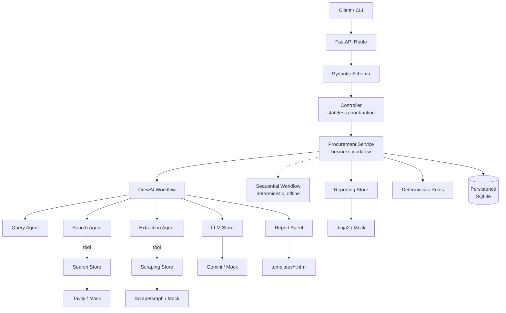

# AI Procurement Agent

A production-grade multi-agent AI system that researches what a company should buy,
from search query to a decision-ready procurement report.

**CrewAI** orchestrates four specialist agents · **FastAPI** exposes a clean API ·
**deterministic code** enforces every business guarantee · **348 offline tests** prove
it works without a single API key.

[](./.github/workflows/ci.yml)


---

## Project overview

You give it a product requirement and the marketplaces you can buy from:

```json
{
  "product": "coffee machine for the office",
  "websites": ["www.amazon.eg", "www.jumia.com.eg", "www.noon.com/egypt-en"],
  "country": "Egypt",
  "language": "English",
  "max_queries": 10,
  "score_threshold": 0.10,
  "top_n": 10
}
```

It returns ranked, structured product data with prices, discounts, specifications and
agent notes — plus a professional HTML/Markdown/JSON procurement report with a
findings table, price statistics and recommendations.

Everything is real: validated URLs, scraped product pages, deterministic price math,
persisted runs and typed errors for every failure mode.

---

## The problem

Procurement product research is manual, repetitive and error-prone:

* the same product is listed at wildly different prices across marketplaces;
* search results are polluted by category pages, blogs, login walls and trackers;
* prices, discounts and specifications have to be read off each product page;
* "cheapest" is not the same as "best value", and someone has to justify the choice.

Doing that by hand does not scale, and doing it with an LLM alone is not trustworthy:
a model will happily return a category page, a duplicate offer, a `0.00` price or a URL
that does not exist.

## The solution

A pipeline that gives **reasoning to the LLM** and **guarantees to code**:

```text
1. Query Agent        generates high-intent, marketplace-targeted search queries
                                    |
2. Search Agent       executes them, validates URLs and relevance scores
                                    |
   Deterministic rules  URL validity · allowed domains · suspicious/non-product pages
                        score thresholds · price/title sanity · deduplication · ranking
                                    |
3. Extraction Agent   scrapes each product page and ranks offers 1-5 with notes
                                    |
4. Report Agent       writes the eight report sections (content, never HTML)
                                    |
   Reporting store      Jinja2 renders the content into a professional document
```

If a model misbehaves, the rules catch it and the run explains what was dropped in
`warnings`. Guarantees never depend on model behaviour.

---

## Architecture



Every external system sits behind **Interface → Factory → Provider**, so
`Gemini → OpenAI`, `Tavily → another search engine`, `ScrapeGraph → another scraper`
and `Jinja → another renderer` are configuration changes, not refactors.

Layers and their rules:

```text
Routes        HTTP contracts only            no business logic, no SQL, no providers
Schemas       Pydantic data contracts        no logic, no side effects
Controllers   stateless coordination         no business rules
Services      the AI workflow + rules        no HTTP, no concrete providers
Persistence   SQLite + in-memory repositories no SQL leaks upward
Stores        Interface -> Factory -> Provider  never imported by name in services
Utils         config, logging, errors, retry, observability
```

See [`docs/ARCHITECTURE.md`](docs/ARCHITECTURE.md) for the full rationale.

---

## Features

**AI workflow**

* Four specialist CrewAI agents with prompts stored as reviewable Markdown files.
* Strict Pydantic structured outputs per agent (`SuggestedSearchQueries`,
  `SearchResults`, `Products`, `ProcurementReport`).
* Provider-agnostic agent tools: agents reach the search engine and scraper only
  through store interfaces.
* A deterministic workflow that runs the same pipeline offline — used by CI, tests and
  local development, and available as graceful degradation.

**Engineering**

* Clean Architecture with a single composition root; no cycles, enforced offline tests.
* Deterministic rules for URL validation, product filtering, deduplication and ranking.
* Typed error hierarchy (`ProviderAuthError`, `ProviderRateLimitError`,
  `ProviderTimeoutError`, `ProviderUnavailableError`, `ProviderResponseError`, …) with
  secret redaction and stable HTTP mapping.
* Bounded retries with transient-vs-permanent classification; never retries auth or
  validation failures.
* Graceful degradation with an explicit `warnings` list and
  `completed | partial | failed` status.
* SQLite persistence (stdlib only) plus `GET /api/v1/procurement/{id}` for report
  retrieval.
* Centralised pydantic-settings configuration with `SecretStr` credentials, `APP_*`
  namespacing, and fail-fast consistency checks.
* Optional, fail-safe AgentOps observability that never breaks a request and never
  fakes success.
* Docker, Docker Compose, Make targets, a CLI, CI on three Python versions, a secret
  scan, and an offline smoke test.

**Reporting**

* Eight sections: Executive Summary, Introduction, Methodology, Findings, Analysis,
  Recommendations, Conclusion, Appendices.
* Bootstrap 5 HTML with a product table, price cards and a Chart.js price chart.
* Markdown and JSON renderings; autoescaping protects against hostile scraped content.

---

## Tech stack

| Concern | Technology |
| --- | --- |
| Agent orchestration | CrewAI 1.15 |
| Model provider | Google Gemini (native, via CrewAI) |
| Search | Tavily |
| Scraping | ScrapeGraphAI |
| API | FastAPI + Uvicorn |
| Contracts / config | Pydantic v2, pydantic-settings |
| Templates | Jinja2 |
| Persistence | SQLite (`sqlite3`, stdlib) |
| Observability | AgentOps (optional, fail-safe) |
| Tooling | pytest, ruff, mypy, Docker, GitHub Actions |

---

## Installation

Requires Python 3.11–3.13.

```bash
git clone https://github.com/AhmedSho3ib/AI-Procurement-Agent.git
cd AI-Procurement-Agent

python -m venv .venv
# Windows (PowerShell)
.venv\Scripts\Activate.ps1
# macOS / Linux
source .venv/bin/activate

pip install -e ".[dev]"
cp .env.example .env      # fill in the credentials you need
```

`pyproject.toml` is the source of truth for dependencies. Two pinned requirements
files are also provided for environments that consume them directly (buildpacks,
older CI runners, reproducible reviews):

```bash
pip install -r requirements.txt        # runtime only, exact pins
pip install -r requirements-dev.txt    # runtime + pytest/ruff/mypy, exact pins
# or: make req / make req-dev
```

A test (`tests/unit/utils/test_requirements_files.py`) fails if the requirements
files drift from `pyproject.toml`, stop using exact pins, or if a pin falls outside
the declared version range — so they cannot rot.

Want to try it without any credentials?

```bash
python scripts/smoke_test.py --output-dir ai-agent-output
```

---

## Environment variables

Copy [`.env.example`](.env.example) to `.env`. That file contains **placeholders only** —
never commit `.env` (it is git-ignored, and CI fails if a credential shape is found in
tracked files).

Naming convention:

* `APP_*` — application behaviour (`APP_PORT`, `APP_ENVIRONMENT`, `APP_LOG_LEVEL`, …).
  Namespaced on purpose: an ambient `DEBUG` or `PORT` in a host environment must not
  silently reconfigure the service. This project hit exactly that collision during
  development.
* canonical names — `GOOGLE_API_KEY`, `GOOGLE_MODEL`, `TVLY_API_KEY`,
  `SCRAPEGRAPH_API_KEY`, `AGENTOPS_API_KEY`.

Selection and reliability:

| Variable | Values | Default | Purpose |
| --- | --- | --- | --- |
| `APP_LLM_PROVIDER` | `gemini`, `mock` | `gemini` | LLM provider |
| `APP_SEARCH_PROVIDER` | `tavily`, `mock` | `tavily` | Search provider |
| `APP_SCRAPER_PROVIDER` | `scrapegraph`, `mock` | `scrapegraph` | Scraping provider |
| `APP_REPORT_PROVIDER` | `jinja`, `mock` | `jinja` | Report renderer |
| `APP_WORKFLOW` | `crew`, `sequential` | `crew` | Agentic vs deterministic pipeline |
| `APP_PERSISTENCE_BACKEND` | `sqlite`, `memory` | `sqlite` | Run storage |
| `APP_MAX_RETRIES` | 1–10 | `3` | Bounded retries for transient failures |
| `APP_REQUEST_TIMEOUT_SECONDS` | 1–300 | `30` | Provider timeout budget |
| `APP_AGENTOPS_ENABLED` | `true`, `false` | `false` | Optional telemetry |

> **Rotate any credential that has ever been written into a notebook, log file or
> commit.** The original prototype kept keys in `.env` and used them from
> `notebooks/CrewAI.ipynb`; treat those values as compromised.

Verify your configuration (never prints secret values):

```bash
python scripts/check_providers.py              # offline report
python scripts/check_providers.py --network    # live credential verification
```

---

## Running

### API

```bash
python main.py                     # project-root entrypoint
# or
python -m src.main
# or
make run
# or
python -m uvicorn src.main:create_app --factory --host 0.0.0.0 --port 8000
```

The host, port and other app behaviour come from `APP_HOST`/`APP_PORT` in `.env`
(default port `8000`), so the effective docs URL is
<http://localhost:8000/docs> unless you change it.

### CLI

```bash
procure --product "coffee machine for the office" \
        --websites "www.amazon.eg,www.jumia.com.eg,www.noon.com/egypt-en" \
        --output procurement-report.html

# offline, deterministic, no credentials
procure --product "coffee machine for the office" --workflow sequential \
        --llm-provider mock --search-provider mock --scraper-provider mock \
        --persistence memory --format markdown --output report.md

# same response schema as the API
procure --product "office chair" --json
```

### Tests

```bash
make test        # pytest
make test-cov    # with coverage
make lint        # ruff
make typecheck   # mypy
make smoke       # offline end-to-end pipeline
```

### Docker

```bash
docker build -t ai-procurement-agent:latest .
docker run --rm -p 8000:8000 --env-file .env ai-procurement-agent:latest

# or
docker compose up --build
```

---

## API example

```bash
curl -X POST http://localhost:8000/api/v1/procurement \
  -H "Content-Type: application/json" \
  -d '{
    "product": "coffee machine for the office",
    "websites": ["www.amazon.eg", "www.jumia.com.eg", "www.noon.com/egypt-en"],
    "country": "Egypt",
    "language": "English",
    "max_queries": 10,
    "score_threshold": 0.10,
    "top_n": 10
  }'
```

Trimmed response:

```json
{
  "request_id": "0e2f1f0a-9f4d-4f7b-b1c9-6f8d2b6a1c33",
  "status": "completed",
  "queries": [
    "DeLonghi Magnifica S automatic coffee machine site:amazon.eg",
    "Nespresso Vertuo Next coffee machine site:noon.com/egypt-en"
  ],
  "products": [
    {
      "page_url": "https://www.amazon.eg/DeLonghi-Magnifica-Automatic-Coffee-Machine/dp/B00400OMU0",
      "product_title": "De'Longhi Magnifica S Automatic Coffee Machine, ECAM 22.110.B, Black",
      "product_image_url": "https://m.media-amazon.com/images/I/61+DeLonghi-Magnifica-S.jpg",
      "product_url": "https://www.amazon.eg/DeLonghi-Magnifica-Automatic-Coffee-Machine/dp/B00400OMU0",
      "product_current_price": 24999.0,
      "product_original_price": null,
      "product_discount_percentage": null,
      "product_currency": "EGP",
      "product_specs": [
        { "specification_name": "Type", "specification_value": "Automatic" },
        { "specification_name": "Grinder", "specification_value": "Integrated" }
      ],
      "agent_recommendation_rank": 5,
      "agent_recommendation_notes": ["Best value for an office environment."]
    }
  ],
  "price_summary": {
    "product_count": 10,
    "currency": "EGP",
    "min_price": 1450.0,
    "max_price": 65000.0,
    "average_price": 12840.3,
    "median_price": 3100.0,
    "cheapest_product_title": "Fresh Coffee Maker, 1000 Watt, 1.2 Liter"
  },
  "report": { "format": "html", "content": "<!DOCTYPE html> ..." },
  "warnings": ["Filtered 4 of 30 search results (low score, invalid URL or non-product page)."],
  "duration_ms": 41857
}
```

Other endpoints:

```bash
curl http://localhost:8000/health
curl http://localhost:8000/api/v1/procurement/0e2f1f0a-9f4d-4f7b-b1c9-6f8d2b6a1c33
```

Full reference: [`docs/API.md`](docs/API.md).

---

## Testing

The suite is fully offline: mock providers, in-memory or temporary SQLite, and
`_env_file=None` so a developer's real `.env` can never influence a result. No test
requires Google, Tavily, ScrapeGraph or AgentOps.

```bash
pytest                              # everything
pytest tests/unit                   # unit only
pytest -m integration               # API tests only
pytest -k "url_validation or deduplication"
pytest --cov=src --cov-report=term-missing
```

What is covered:

* **Schemas** — validation, normalization, bounds, strictness.
* **Rules** — URL validity, suspicious/non-product pages, domain allow-lists,
  normalization, product identifiers, score/price/title filtering, deduplication,
  ranking, price statistics.
* **Service** — full orchestration, deterministic post-processing, top-N truncation,
  status semantics, persistence, and every degradation path.
* **Crew** — four agents, four tasks, structured output models, tool wiring, prompt
  rendering, task context, output parsing and provider-error classification.
* **Stores** — factories and provider swapping, mock determinism, Tavily/ScrapeGraph
  adapters against fake SDK clients, Gemini configuration and error handling, report
  rendering (HTML/Markdown/JSON, escaping, failures), retry policy, secret redaction.
* **API** — health, full request/response contract, validation, error translation,
  CORS, lifespan.

The prototype's captured artifacts (`tests/fixtures/`) are asserted against, so real
data shapes keep working.

---

## Project structure

```text
AI-Procurement-Agent/
├── main.py                         `python main.py` entrypoint (serves the API)
├── src/
│   ├── main.py                     FastAPI factory, middleware, error handlers, lifespan
│   ├── container.py                Composition root
│   ├── cli.py                      `procure` CLI (reuses controller + service)
│   ├── routes/                     health, procurement, dependencies
│   ├── controllers/                BaseController, procurement_ctrl
│   ├── services/procurement_service/
│   │   ├── procurement_service.py  Run orchestration, rules, reporting, persistence
│   │   ├── workflow.py             Workflow contract + WorkflowContext + output parsing
│   │   ├── crew.py                 CrewAI workflow (4 agents, 4 tasks, tools)
│   │   ├── sequential.py           Deterministic offline workflow
│   │   ├── agents/                 One module per agent (+ its store-backed tool)
│   │   ├── tasks/                  One module per task (structured outputs)
│   │   ├── rules/                  url_validation, product_filtering, deduplication
│   │   └── prompts/                One Markdown prompt file per agent
│   ├── schemas/                    procurement, products, search, reports
│   ├── persistence/models/         SQLite + in-memory repositories
│   ├── stores/llm|search|scraping|reporting/   Interface -> Factory -> Provider
│   └── utils/                      config, logging, exceptions, retry, observability
├── templates/                      procurement_report.html, procurement_report.md.jinja
├── tests/                          unit + integration + fixtures
├── scripts/                        smoke_test.py, check_providers.py
├── docs/                           ARCHITECTURE.md, API.md, DEVELOPMENT.md
├── notebooks/                      the original prototype + captured outputs
├── .github/workflows/ci.yml        lint, format, types, tests, smoke, secret scan, Docker
├── Dockerfile · docker-compose.yml · Makefile · pyproject.toml
├── requirements.txt                pinned runtime dependencies (mirrors pyproject.toml)
├── requirements-dev.txt            pinned test/lint/type dependencies
└── .env.example · .gitignore · LICENSE · README.md
```

---

## Future improvements

Realistic next steps, in rough priority order:

1. **Streaming & async jobs** — a `POST` that returns a job id plus SSE/websocket
   progress for runs that take tens of seconds today.
2. **Scheduled price monitoring** — re-run stored requests on a schedule and diff
   prices, with the persistence layer already holding the audit trail.
3. **Currency normalization** — convert across currencies (needs an FX provider and a
   configurable policy).
4. **Retrieval-augmented ranking** — embed specifications and past purchases so
   ranking reflects the company's actual preferences, not just price.
5. **Provider breadth** — an `OpenAIProvider` and an `AnthropicProvider` (one enum
   value and one class each), plus `BraveProvider`/`SerpApiProvider` for search.
6. **Semantic caching** — cache query→search→scrape results to cut cost and latency on
   repeat runs.
7. **Postgres + Alembic** — when multi-instance deployment makes SQLite the bottleneck,
   implemented as a third repository behind the same contract.
8. **Evaluation harness** — a labelled set of products with expected best picks, scored
   automatically on each prompt change.
9. **Prompt versioning & A/B testing** — track prompt revisions against run outcomes.

Out of scope by design: Kafka, Celery, Redis, Kubernetes, microservices and event
buses. This is a modular monolith, and the store interfaces already mark the seams
where extraction would be justified.

---

## License

MIT — see [LICENSE](LICENSE).
